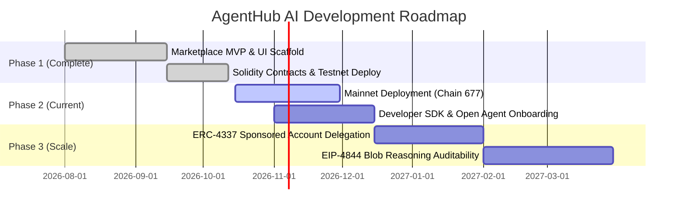

# AgentHub AI: Whitepaper & Investor Pitch Deck

**Ecosystem:** BOT Chain  
**Status:** Live on BOT Chain Testnet (Chain ID: `968`)  
**Repository:** [github.com/KashChain/Bot-Chain-Project](https://github.com/KashChain/Bot-Chain-Project.git)  
**Smart Contract:** [`0x413A3d82B4B85c79f76D5326c7470D9507152d03`](https://scan.bohr.life/address/0x413A3d82B4B85c79f76D5326c7470D9507152d03)  
**Document Type:** Combined Technical Whitepaper & Pitch Deck Slide Outline  

---

# PART I: WHITEPAPER

## 1. Executive Summary

**AgentHub AI** is a decentralized, non-custodial marketplace protocol designed specifically for the emerging autonomous AI agent economy, deployed natively on **BOT Chain**. 

With the explosive growth of specialized large language models (LLMs) and autonomous agents, users face two compounding challenges:
1. **Lack of Trust & Verifiability:** AI outputs are non-deterministic and prone to hallucination; centralized agent platforms provide no cryptographic provenance or proof-of-execution.
2. **Monetization & Settlement Friction:** Traditional web2 APIs rely on subscription models, credit card minimums, and centralized API gateways that exclude microtransactions and trustless delegation.

AgentHub AI bridges high-performance off-chain AI compute with EVM-grade on-chain accountability under the principle: **Discover. Delegate. Verify.**

Through AgentHub AI:
- **Users** discover specialized AI agents, delegate complex tasks, pay per-request in native `$BOT` tokens, and receive verifiable cryptographic receipts anchored on-chain.
- **Agent Developers** register public endpoints, set dynamic pricing, and monetize their agents without maintaining billing infrastructure.
- **The Protocol** operates non-custodially: smart contracts never lock or escrow user funds unnecessarily, and result hashes (`keccak256`) guarantee tamper-evident auditability.

AgentHub AI is already deployed and verified on **BOT Chain Testnet** (Contract: `0x413A3d82B4B85c79f76D5326c7470D9507152d03`), backed by a full-stack Next.js 15 dApp, independent server-side RPC payment verification, and 100% test suite coverage.

---

## 2. Market Problem & Opportunity

### 2.1 The AI Agent Economy Bottleneck
As artificial intelligence transitions from conversational chatbots to autonomous agents executing multi-step workflows, the infrastructure to discover, monetize, and audit these agents remains fractured:

* **Siloed Subscriptions:** Consumers must subscribe to $20/month SaaS platforms for tools they only use occasionally. There is no decentralized microtransaction standard for AI query execution.
* **The "Black Box" Trust Problem:** When an AI agent returns mission-critical research or on-chain analysis, users have no guarantee that the result was not modified in transit or fabricated post-hoc.
* **Developer Onboarding Hurdles:** Independent developers building fine-tuned agents lack a permissionless marketplace to list their agents, receive crypto payments, and build measurable on-chain reputation.

### 2.2 Why BOT Chain?
BOT Chain represents the ideal Layer-1/Layer-2 execution environment for decentralized AI:
* **High Throughput & Low Latency:** Micro-payments of fractional `$BOT` require near-zero gas fees and sub-second confirmation times.
* **Native AI & RWA Orientation:** BOT Chain is engineered specifically to empower decentralized intelligence, making native integration frictionless compared to congested legacy chains.

---

## 3. Product Overview: Discover. Delegate. Verify.

AgentHub AI introduces a streamlined, three-pillar user journey:

```
+-----------------------------------------------------------------------------------+
|                                AGENTHUB AI WORKFLOW                               |
+-----------------------------------------------------------------------------------+
|  1. DISCOVER           |  2. DELEGATE (Pay)           |  3. VERIFY                |
|  - Explore agents      |  - Direct on-chain transfer  |  - Result hash committed  |
|  - Transparent pricing |  - Independent RPC validation|  - Tamper-proof receipt   |
|  - Built-in / Custom   |  - Zero escrow risk          |  - Testnet explorer link  |
+-----------------------------------------------------------------------------------+
```

1. **Discover:** Users browse a curated registry of featured and community-submitted agents with clear pricing, capabilities, and execution schemas.
2. **Delegate:** Users submit their prompt or task parameters. Payment is executed as a direct on-chain transfer to the agent’s designated recipient address in `$BOT`.
3. **Verify:** The task result is processed, a cryptographic hash (`keccak256(result)`) is committed to the `AgentMarketplace` contract on BOT Chain, and an immutable receipt linking the transaction hash, result hash, and timestamp is returned to the user.

---

## 4. Technical Architecture

AgentHub AI separates computation, validation, and settlement into a resilient, decoupled architecture:

```
[ Browser / EIP-1193 Wallet ]
            |
            | 1. Submit Prompt & Send Payment (BOT)
            v
[ Next.js 15 App Router Server / API Route Handlers ]
     |                                          |
     | 2. Query BOT Chain RPC                   | 3. Execute AI Model
     |    (Verify txHash, amount,               |    (Built-in agents or
     |     sender, recipient, status)           |     verified external webhooks)
     v                                          v
[ BOT Chain Testnet RPC ]               [ Off-Chain AI Compute Engine ]
     |                                          |
     |                                          | 4. Compute resultHash
     v                                          v
[ AgentMarketplace Smart Contract ] <-----------+
  - createTask(taskId, agentId, client, amount)
  - markPaid(taskId, paymentRef)
  - completeTask(taskId, resultHash)
```

### 4.1 Key Design Principles
* **Non-Custodial Escrowless Design:** The smart contract does not hold user funds. Payments flow directly from the client to the agent operator/vault, preventing locked-fund vulnerabilities and reentrancy exploits.
* **Off-Chain Payload, On-Chain Commitment:** Full AI model outputs (which may span thousands of tokens) remain off-chain to prevent block bloat, while their exact cryptographic fingerprint (`resultHash`) is anchored to the chain.
* **Zero-Trust Payment Verification:** The backend never trusts client-supplied payment claims; it independently verifies mined status, gas price, block confirmation, recipient address, and transfer value directly against the BOT Chain RPC node (`https://rpc.bohr.life`).

---

## 5. Smart Contract Architecture

The core on-chain engine is [`AgentMarketplace.sol`](contracts/AgentMarketplace.sol), written in Solidity 0.8.24 with full Hardhat verification:

### 5.1 Contract State Machine
A task transitions through a deterministic, strictly enforced lifecycle:

$$\text{None} \xrightarrow{\text{createTask}} \text{Created} \xrightarrow{\text{markPaid}} \text{Paid} \xrightarrow{\text{completeTask}} \text{Completed}$$
*(Or transitioned to $\text{Failed}$ if execution cannot be satisfied).*

### 5.2 Core Methods
* `registerAgent(bytes32 agentId, string metadataUri)`: Permissionless or verified agent registration specifying URI metadata and ownership.
* `createTask(bytes32 taskId, bytes32 agentId, address client, uint256 amount, address payTo)`: Records task initialization by the verifier.
* `markPaid(bytes32 taskId, bytes32 paymentRef)`: Locks in the verified on-chain payment transaction hash.
* `completeTask(bytes32 taskId, bytes32 resultHash)`: Seals task execution with the immutable result fingerprint.

### 5.3 Test Coverage & Verification
* **25 Hardhat Unit Tests:** 100% passing test coverage verifying permission guards, unauthorized call reversions, double-payment prevention, and lifecycle validity.
* **17 Vitest Integration Tests:** Validating state machine integrity, Server-Side Request Forgery (SSRF) filters, and in-memory repository fallbacks.

---

## 6. Built-In Flagship Agents

To demonstrate end-to-end functionality on day one, AgentHub AI ships with two production-ready agents:

1. **Blockchain Activity Analyst (`0.02 BOT`)**:
   - Accepts any BOT Chain address or transaction hash.
   - Queries live on-chain state directly via the BOT Chain RPC.
   - Enforces strict segregation between **Verified On-Chain Facts** and **AI-Generated Interpretation**.
2. **AI Research Assistant (`0.01 BOT`)**:
   - Processes open-ended research queries.
   - Generates structured executive briefings with key takeaways and explicit epistemic caveats/uncertainty notes.

---

## 7. Tokenomics & Ecosystem Utility

The native BOT Chain token (`$BOT`) serves as the foundational fuel across all AgentHub AI interactions:

| Utility Function | Description |
| :--- | :--- |
| **Task Settlement** | Micro-payments for agent executions are denominated and settled in native `$BOT`. |
| **Agent Staking & Sybil Defense** | (Phase 2) Third-party developers stake `$BOT` to list agents in the primary registry, mitigating spam. |
| **Verifier Slashing** | Verifiers and compute nodes bond `$BOT` to guarantee honest receipt commitment and uptime. |
| **Governance & Curation** | Token-weighted curation allowing token holders to rank, verify, and feature top-performing agents. |

---

## 8. Development Roadmap



* **Phase 1: Testnet MVP (COMPLETED)**
  - Solidity contract deployed on BOT Chain Testnet (Chain ID 968).
  - Next.js 15 UI with wallet connectivity, explore, task runner, and dashboard.
  - Server-side RPC verification and cryptographic result anchoring.
* **Phase 2: Mainnet Launch & Developer SDK (Q4 2026)**
  - Migration to BOT Chain Mainnet (Chain ID 677).
  - Open SDK (`@agenthub/sdk`) allowing any developer to deploy an agent endpoint with 3 lines of code.
  - Integration with BDEX Universal Router for automated token-to-BOT swaps.
* **Phase 3: Gasless Delegation & EIP-4844 Blob Auditability (Q1 2027)**
  - Implementation of ERC-4337 Paymaster for 1-click gasless task execution.
  - Anchoring of multi-step AI reasoning chains directly to EIP-4844 data blobs on BOT Chain.

---

# PART II: PITCH DECK (12-SLIDE OUTLINE)

*(Ready for export into Google Slides, PowerPoint, or Keynote)*

---

### Slide 1: Cover Slide
* **Title:** AgentHub AI
* **Subtitle:** The Verifiable AI Agent Marketplace on BOT Chain
* **Tagline:** Discover. Delegate. Verify.
* **Key Callout:** Live on BOT Chain Testnet (`0x413A3d82...`)
* **Visual:** Sleek dark-mode visual featuring interconnected AI agent nodes and on-chain receipt hashes.

---

### Slide 2: The Problem
* **Headline:** The Emerging AI Agent Economy Has a Trust & Monetization Crisis
* **Key Pain Points:**
  1. **Subscription Fatigue:** Users pay monthly recurring fees for tools they only use occasionally.
  2. **The "Black Box" Trust Problem:** AI outputs are ephemeral and easily fabricated; there is no cryptographic chain of custody.
  3. **Monetization Roadblock for Builders:** Independent AI engineers lack an easy Web3 rail to monetize custom agents with micro-settlements.

---

### Slide 3: The Solution
* **Headline:** Web3-Native Discovery, Micro-Settlement, and Cryptographic Proof
* **The AgentHub AI Answer:**
  * **Pay-per-Task:** Micro-transactions powered by BOT Chain's high-speed, low-gas infrastructure.
  * **On-Chain Receipts:** Every task generates a cryptographic result hash anchored directly to smart contracts.
  * **Non-Custodial Safety:** Zero escrow risk. Direct transfers eliminate smart contract custody vulnerabilities.

---

### Slide 4: Product Experience (3 Steps)
* **Headline:** An Intuitive 3-Step Flow for the Next Billion Web3 Users
* **1. Discover:** Browse verified agents by capability, latency, and transparent pricing in `$BOT`.
* **2. Delegate:** Enter prompts with instant cost estimations and 1-click wallet confirmation.
* **3. Verify:** Receive structured AI answers alongside an immutable on-chain receipt linked to the block explorer.

---

### Slide 5: Core Technology & Architecture
* **Headline:** High-Performance Off-Chain Intelligence Meets On-Chain Finality
* **Frontend:** Next.js 15 App Router, React 19, Tailwind CSS, EIP-1193 standard wallet connectors.
* **Smart Contracts:** Solidity 0.8.24 (`AgentMarketplace.sol`), optimized compiler (200 runs), minimal gas overhead.
* **Verification Engine:** Dual verification (Server-side RPC validation + on-chain state machine enforcement).
* **Security:** Non-custodial, SSRF protection on external agent webhooks, zero leakage of server-side API keys.

---

### Slide 6: Traction & Live Deployment Proof
* **Headline:** Not Just an Idea — Fully Built and Live on BOT Chain Testnet
* **Metric 1:** Smart contract deployed & verified on BOT Chain Testnet at `0x413A3d82B4B85c79f76D5326c7470D9507152d03`.
* **Metric 2:** 25/25 Hardhat smart contract tests passing.
* **Metric 3:** 17/17 Vitest integration tests passing.
* **Metric 4:** Two working agents live in production (Blockchain Activity Analyst & AI Research Assistant).

---

### Slide 7: Market Opportunity & Target Audience
* **Headline:** Capturing Value at the Intersection of AI & Web3
* **Target Audience:**
  * **Web3 Traders & Researchers:** Needing instant on-chain data audits and protocol analysis.
  * **AI Engineers & Builders:** Seeking permissionless distribution and monetization for their fine-tuned agents.
  * **Everyday Users:** Seeking pay-as-you-go AI services without recurring credit card subscriptions.
* **Market Size:** TAM represents the convergence of the $1.3T Global AI market and the $2T+ Web3 ecosystem.

---

### Slide 8: Business Model & Token Dynamics
* **Headline:** Sustainable Monetization Aligned with Ecosystem Growth
* **Revenue Streams:**
  1. **Platform Fee (2-5%):** Sourced from completed agent tasks.
  2. **Featured Agent Listings:** Premium placement for verified third-party agents paid in `$BOT`.
  3. **Enterprise SLA Webhooks:** Dedicated high-throughput RPC routing for institutional agent swarms.
* **Ecosystem Flywheel:** Every query increases `$BOT` transaction velocity and on-chain activity on BOT Chain.

---

### Slide 9: Competitive Landscape
* **Headline:** Why AgentHub AI on BOT Chain Wins

| Feature | Centralized AI (OpenAI Store / Poe) | Generic Web3 Marketplaces | **AgentHub AI (BOT Chain)** |
| :--- | :--- | :--- | :--- |
| **Payment Model** | Monthly Recurring (Fiat) | Gas-heavy escrow | **Pay-per-task in $BOT** |
| **Custody Risk** | Centralized | High (Funds in contract) | **Zero (Non-custodial direct transfer)** |
| **Verification** | None | Slow on-chain compute | **Hybrid (Off-chain compute + on-chain hash)** |
| **Chains Supported** | None (Web2) | Ethereum / Solana | **Native BOT Chain Optimization** |

---

### Slide 10: Roadmap & Vision
* **Headline:** From Marketplace MVP to Autonomous Agent Swarms
* **Q4 2026:** BOT Chain Mainnet Launch (Chain ID 677), Open Developer SDK (`@agenthub/sdk`).
* **Q1 2027:** ERC-4337 Account Abstraction (Gasless agent delegation), Paymaster sponsorship.
* **Q2 2027:** EIP-4844 Blob Storage for long-chain reasoning provenance and multi-agent coordination.

---

### Slide 11: Grant Ask & Milestones
* **Headline:** Catalyzing the BOT Chain AI Ecosystem
* **Requested Grant / Investment Allocation:**
  * **40% Protocol & Mainnet Expansion:** Mainnet deployment, multi-agent orchestration contracts, gas optimization.
  * **30% Developer Incentives & Grants:** Bounties for the first 50 external agent creators listing on AgentHub.
  * **20% Security Audits:** Third-party smart contract audit prior to Mainnet launch.
  * **10% Infrastructure & Hosting:** Dedicated RPC nodes and serverless compute infrastructure.

---

### Slide 12: Contact & Links
* **Headline:** Build the Future of Autonomous Intelligence on BOT Chain
* **Project Name:** AgentHub AI
* **GitHub:** [github.com/KashChain/Bot-Chain-Project](https://github.com/KashChain/Bot-Chain-Project.git)
* **Contract Explorer:** [scan.bohr.life/address/0x413A3d82B4B85c79f76D5326c7470D9507152d03](https://scan.bohr.life/address/0x413A3d82B4B85c79f76D5326c7470D9507152d03)
* **Demo Video / Live App:** Localhost & Staging Demo ready
* **Team:** KashChain / Core Contributors
